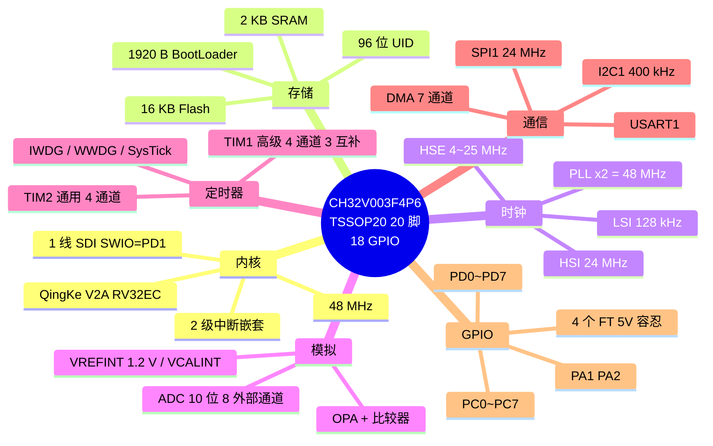

# CH32V003 引脚配置与芯片资源 · 详细指南

> **数据来源**：WCH 官方《CH32V003 Datasheet》**V1.8**（2025-10-17，37 页，本仓库 `Datasheet/CH32V003DS0.PDF`）——§1.2 存储器与启动（PDF p.7）、§1.3 时钟树（p.5-6）、§1.4 功能描述（p.7-11）、**§2.1 封装引脚图（PDF p.12-13）**、**§2.2 引脚定义表 Table 2-1（p.13-14）**、**§2.3 复用/重映射表 Table 2-2（p.15）**、§3 电气特性（p.16-31）、§4 封装与订货（p.32-35）。
>
> **适用芯片**：CH32V003 系列，QingKe V2A 内核，RV32EC，最高 48 MHz。
>
> **本工程上下文**：`ch32v003-blink` 使用 **CH32V003F4P6（TSSOP20，20 脚 / 18 GPIO）**，LED 接 **PD0**，系统时钟 **HSI 24 MHz × PLL2 = 48 MHz**，调试/烧录使用 **PD1（SWIO）**。本文所有「如何配置」示例都与本工程代码对齐。

---

## 目录

- [1. 芯片与封装总览](#1-芯片与封装总览)
- [2. 封装引脚图](#2-封装引脚图)
- [3. TSSOP20 全引脚定义（F4P6 主表）](#3-tssop20-全引脚定义f4p6-主表)
- [4. 引脚类型与电气约束](#4-引脚类型与电气约束)
- [5. 外设引脚分配](#5-外设引脚分配)
- [6. AFIO 重映射机制](#6-afio-重映射机制)
- [7. 时钟系统](#7-时钟系统)
- [8. 存储器与启动](#8-存储器与启动)
- [9. 外设资源详解](#9-外设资源详解)
- [10. 电气特性摘录](#10-电气特性摘录)
- [11. 本工程引脚使用与修改](#11-本工程引脚使用与修改)
- [12. 常见坑 FAQ](#12-常见坑-faq)
- [13. 参考资料](#13-参考资料)

---

## 1. 芯片与封装总览

### 1.1 型号与封装

数据手册 Table（PDF p.2）：

| 型号 | Flash | SRAM | 引脚数 | GPIO | ADC 通道 | SPI | I2C | USART | 封装 |
| --- | :-: | :-: | :-: | :-: | :-: | :-: | :-: | :-: | --- |
| **CH32V003F4P6** | 16 KB | 2 KB | 20 | **18** | 8 | 1 | 1 | 1 | **TSSOP20**（本工程） |
| CH32V003F4U6 | 16 KB | 2 KB | 20 | 18 | 8 | 1 | 1 | 1 | QFN20 |
| CH32V003A4M6 | 16 KB | 2 KB | 16 | 14 | 6 | — | 1 | 1 | SOP16 |
| CH32V003J4M6 | 16 KB | 2 KB | 8 | 6 | 6 | 1 | 1 | 1 | SOP8 |

> 📌 型号表中的 SPI/ADC 列是「芯片 die 资源」，**是否引出到封装要看 §2 引脚表**。例如 SOP16 没有 PC5（SPI_SCK），SOP8 没有 PC5/PC6/PC7，因此这两个封装无法使用完整 SPI。选型时以引脚表为准。

### 1.2 芯片资源总表

| 项目 | 参数 |
| --- | --- |
| 内核 | QingKe V2A，**RV32EC**（RISC-V E 子集 + 压缩指令），机器模式 |
| 最高主频 | **48 MHz**（HSI 24 MHz × PLL2；AHB 最高 50 MHz） |
| Flash | **16 KB CodeFlash**（用户程序） |
| SRAM | **2 KB**（0x2000 0000） |
| 系统区 | **1920 B BootLoader** + 64 B 系统配置 + 64 B 用户配置 |
| 工作电压 | **VDD 2.7 ~ 5.5 V**（ADC 推荐 ≥ 2.8 V） |
| 温度 | -40 ~ 85 ℃（结温 -40 ~ 105 ℃） |
| GPIO | 3 组端口（A/C/D），最多 **18 个**；无 Port B |
| DMA | **7 通道**，支持环形缓冲，TIMx/ADC/USART/I2C/SPI 请求 |
| ADC | **10 位**，8 个外部通道 + 2 个内部通道（VREFINT / VCALINT） |
| OPA | 1 组运放/比较器，可接 ADC 与 TIM2_CH1 |
| 定时器 | TIM1（16 位高级，4 通道，3 对互补，死区/刹车）、TIM2（16 位通用，4 通道）、IWDG、WWDG、SysTick（32 位） |
| 通信 | 1 × USART、1 × I2C（标准/快速 400 kHz）、1 × SPI（最高 24 MHz） |
| 调试 | **1 线 SDI：SWIO = PD1**（上电默认开启，需 HSI 时钟） |
| 安全 | 96 位唯一 ID |
| 中断 | PFIC，2 级中断嵌套，硬件中断栈（HPE） |
| 封装 | TSSOP20 / QFN20 / SOP16 / SOP8 |

### 1.3 资源一图流



---

## 2. 封装引脚图

### 2.1 TSSOP20 — CH32V003F4P6（本工程）

**俯视图**，Pin 1 在左上角，逆时针编号；左侧 1→10 自上而下，右侧 11→20 自下而上（即右上角是 Pin 20）。

```
                 ┌───────────────────────────┐
        PD4  1 ──┤                           ├── 20 PD3
        PD5  2 ──┤                           ├── 19 PD2
        PD6  3 ──┤                           ├── 18 PD1 / SWIO
        PD7  4 ──┤      CH32V003F4P6         ├── 17 PC7
        PA1  5 ──┤      TSSOP20 (4.4×6.5mm)   ├── 16 PC6
        PA2  6 ──┤      18 GPIO               ├── 15 PC5
        VSS  7 ──┤                           ├── 14 PC4
        PD0  8 ──┤                           ├── 13 PC3
        VDD  9 ──┤                           ├── 12 PC2
        PC0 10 ──┤                           ├── 11 PC1
                 └───────────────────────────┘
```

### 2.2 QFN20 — CH32V003F4U6

**俯视图**，Pin 1 在左上角，逆时针；左侧 1→5、底部 6→10、右侧 11→15、顶部 16→20。中心裸露焊盘（EP）为 **VSS（表中 Pin 0）**，必须接地并散热。

```
                 ┌──── 16 17 18 19 20 ────┐
          PD7 1 ─┤  PD2 PD3 PD4 PD5 PD6   ├─ 15 PD1
          PA1 2 ─┤                        ├─ 14 PC7
          PA2 3 ─┤      QFN20 3×3mm       ├─ 13 PC6
          VSS 4 ─┤      EP = VSS (0)      ├─ 12 PC5
          PD0 5 ─┤                        ├─ 11 PC4
                 └── 6  7  8  9 10 ───────┘
                   VDD PC0 PC1 PC2 PC3
```

### 2.3 SOP16 — CH32V003A4M6

**俯视图**，Pin 1 左上角；左侧 1→8 自上而下，右侧 9→16 自下而上（右上角 Pin 16）。

```
                 ┌─────────────────────────┐
        PC1  1 ──┤                         ├── 16 PC0
        PC2  2 ──┤                         ├── 15 VDD
        PC3  3 ──┤      CH32V003A4M6       ├── 14 VSS
        PC4  4 ──┤      SOP16 3.9×10mm     ├── 13 PA2
        PC6  5 ──┤      14 GPIO            ├── 12 PA1
        PC7  6 ──┤                         ├── 11 PD7
        PD1  7 ──┤                         ├── 10 PD6
        PD4  8 ──┤                         ├──  9 PD5
                 └─────────────────────────┘
```

SOP16 没有 PC0/PC5/PD0/PD2/PD3 中的 **PC5、PD0、PD2、PD3**（见官方库 `GPIO_IPD_Unused()` 的 A4M 分支），因此没有完整 SPI（缺 SCK）。

### 2.4 SOP8 — CH32V003J4M6

8 脚封装，**6 个 GPIO**。可确认的引脚：

| Pin | 功能 |
| :-: | --- |
| 1 | PA1 / PD6（数据手册图中两种标注，见下方警告） |
| 2 | **VSS** |
| 3 | PA2 |
| 4 | **VDD** |
| 5 | PC1 |
| 6 | PC2 |
| 7 | PC4 |
| 8 | PD1 / SWIO（图中同时标有 PD4、PD5） |

> ⚠️ **重要**：V1.8 数据手册的 **Table 2-1 SOP8 列存在明显重复编号**（PD4/PD5/PD1 都写成 8，PD6/PA1 都写成 1），§2.1 的 J4M6 引脚图也在 Pin 1/8 旁印了多组功能。**不要直接按这一列布线**。可确认的是 8 脚、6 GPIO、VSS=2、VDD=4、PC1/PC2/PC4=5/6/7、PD1/SWIO=8。若项目要用 SOP8，建议优先以实物丝印/万用表核对，或改用 F4P6/QFN20。本工程默认 F4P6，不受此问题影响。

---

## 3. TSSOP20 全引脚定义（F4P6 主表）

下表整合数据手册 **Table 2-1（PDF p.13-14）** 的 TSSOP20 列与 **§2.1 引脚图（PDF p.12）**，逐脚核对。

**类型缩写**：

| 缩写 | 含义 |
| --- | --- |
| `I/O` | TTL/CMOS 电平施密特输入 + CMOS 三态输出 |
| `I/O/FT` | 同上，且输入 **5V 容忍**（最高 5.5 V） |
| `I/O/A` | 数字 I/O + **模拟输入/输出**（ADC / OPA） |
| `P` | 电源 |

| Pin | 名称 | 类型 | 复位后主功能 | 默认复用功能 | Remap 复用功能 | 说明 |
| :-: | --- | :-: | --- | --- | --- | --- |
| 1 | **PD4** | I/O/A | PD4 | UCK / T2CH1ETR / A7 / OPO | T1ETR_2 / T1CH4_3 | ADC_IN7；OPA 输出；TIM2_CH1/ETR；USART_CK；TIM1_ETR/CH4 重映射 |
| 2 | **PD5** | I/O/A | PD5 | UTX / A5 | T2CH4_3 / URX_2 | **USART1_TX（默认）**；ADC_IN5；TIM2_CH4 重映射 |
| 3 | **PD6** | I/O/A | PD6 | URX / A6 | T2CH3_3 / UTX_2 | **USART1_RX（默认）**；ADC_IN6；TIM2_CH3 重映射 |
| 4 | **PD7** | I/O/A | PD7 | NRST / T2CH4 / OPP1 | UCK_1 / UCK_2 / T2CH4_2 | **NRST 复用**（需 option byte RST_MODE）；OPA_P1；TIM2_CH4；USART_CK 重映射 |
| 5 | **PA1** | I/O/A | PA1 | T1CH2 / A1 / OPN0 | OSCI / T1CH2_2 | ADC_IN1；TIM1_CH2；OPA_N0；**HSE 输入**（OSCI） |
| 6 | **PA2** | I/O/A | PA2 | T1CH2N / A0 / OPP0 | OSCO / AETR2_1 / T1CH2N_2 | ADC_IN0；TIM1_CH2N；OPA_P0；**HSE 输出**（OSCO） |
| 7 | **VSS** | P | VSS | — | — | 数字地 |
| 8 | **PD0** | I/O/A | PD0 | T1CH1N / OPN1 | SDA_1 / UTX_1 / T1CH1N_2 | ⭐ **本工程 LED**；TIM1_CH1N；OPA_N1；I2C_SDA 重映射 1；USART_TX 重映射 1 |
| 9 | **VDD** | P | VDD | — | — | 电源 2.7~5.5 V，就近 0.1 µF 去耦 |
| 10 | **PC0** | I/O | PC0 | T2CH3 | NSS_1 / UTX_3 / T2CH3_2 / T1CH3_1 | TIM2_CH3；SPI_NSS 重映射；USART_TX 重映射 3；TIM1_CH3 重映射 |
| 11 | **PC1** | I/O/FT | PC1 | SDA / NSS | T1BKIN_1 / T2CH4_1 / T2CH1ETR_2 / URX_3 / T2CH1ETR_3 / T1BKIN_3 | I2C_SDA；SPI_NSS；TIM1_BKIN；TIM2_CH4/CH1ETR；USART_RX 重映射 3；**FT** |
| 12 | **PC2** | I/O/FT | PC2 | SCL / URTS / T1BKIN | AETR_1 / T2CH2_1 / T1ETR_3 / URTS_1 / T1BKIN_2 | I2C_SCL；USART_RTS；TIM1_BKIN/ETR；TIM2_CH2；ADC_ETR；**FT** |
| 13 | **PC3** | I/O | PC3 | T1CH3 | T1CH1N_1 / UCTS_1 / T1CH3_2 / T1CH1N_3 | TIM1_CH3；TIM1_CH1N 重映射；USART_CTS |
| 14 | **PC4** | I/O/A | PC4 | T1CH4 / MCO / A2 | T1CH2N_1 / T1CH4_2 / T1CH1_3 | ADC_IN2；TIM1_CH4；**MCO** 时钟输出；TIM1_CH2N/CH1 重映射 |
| 15 | **PC5** | I/O/FT | PC5 | SCK / T1ETR | T2CH1ETR_1 / SCL_2 / SCL_3 / UCK_3 / T1ETR_1 / T1CH3_3 / SCK_1 | **SPI_SCK**；TIM1_ETR；TIM2_CH1ETR；I2C_SCL 重映射；USART_CK；**FT** |
| 16 | **PC6** | I/O/FT | PC6 | MOSI | T1CH1_1 / UCTS_2 / SDA_2 / SDA_3 / UCTS_3 / T1CH3N_3 / MOSI_1 | **SPI_MOSI**；TIM1_CH1/CH3N；USART_CTS；I2C_SDA 重映射；**FT** |
| 17 | **PC7** | I/O | PC7 | MISO | T1CH2_1 / URTS_2 / T2CH2_3 / URTS_3 / T1CH2_3 / MISO_1 | **SPI_MISO**；TIM1_CH2；TIM2_CH2 重映射；USART_RTS |
| 18 | **PD1** | I/O/A | PD1 | SWIO / T1CH3N / AETR2 | SCL_1 / URX_1 / T1CH3N_1 / T1CH3N_2 | ⭐ **SWIO 调试/烧录**；I2C_SCL 重映射 1；USART_RX 重映射 1；TIM1_CH3N |
| 19 | **PD2** | I/O/A | PD2 | T1CH1 / A3 | T2CH3_1 / T1CH2N_3 / T1CH1_2 | ADC_IN3；TIM1_CH1；TIM2_CH3 重映射 |
| 20 | **PD3** | I/O/A | PD3 | A4 / T2CH2 / AETR / UCTS | T2CH2_2 / T1CH4_1 | ADC_IN4；TIM2_CH2；ADC_ETR；USART_CTS；TIM1_CH4 重映射 |

> 📌 **Remap 后缀规则**（数据手册 Table 2-1 注 2）：`_1` / `_2` / `_3` 表示 AFIO 寄存器对应字段配置为 **01b / 10b / 11b**。例如 `T1CH4_3` 表示 AFIO 对应位 = 11b。
>
> 📌 表中的「默认复用」是外设时钟打开后引脚自动呈现的功能；「Remap」需要额外配置 AFIO（见 §6）。

---

## 4. 引脚类型与电气约束

### 4.1 电压与 5V 容忍

| 项目 | 值 | 依据 |
| --- | --- | --- |
| VDD 工作电压 | **2.7 ~ 5.5 V**（ADC 推荐 2.8 ~ 5.5 V） | Table 3-2 |
| 普通 I/O 输入电压 | VSS-0.3 ~ **VDD+0.3 V** | Table 3-1 |
| FT I/O 输入电压 | VSS-0.3 ~ **5.5 V** | Table 3-1 |
| 5V 容忍引脚 | **PC1、PC2、PC5、PC6**（仅这 4 个） | Table 2-1 的 `I/O/FT` |
| ESD HBM | 4 kV | Table 3-1 |

> ⚠️ 常见误解：VDD 可以接 5 V，不代表所有引脚都能承受 5 V 输入。**只有 PC1/PC2/PC5/PC6 是 FT**；其余引脚（PA1/PA2、PC0/PC3/PC4/PC7、PD0~PD7）输入上限是 **VDD+0.3 V**。如果 VDD=3.3 V，给非 FT 脚输入 5 V 会通过 ESD 二极管灌电流，可能损坏芯片。

### 4.2 驱动能力

| 参数 | 值 | 依据 |
| --- | --- | --- |
| 单个 I/O 灌/拉电流 | **±8 mA**（保证 VOL/VOH） | §3.3.9 |
| 单个 I/O 最大灌/拉电流 | **±20 mA**（不保证 VOL/VOH） | Table 3-1 |
| VDD 总电流 | 100 mA | Table 3-1 |
| VSS 总电流 | 80 mA | Table 3-1 |
| 单脚注入电流 | ±4 mA | Table 3-1 |
| 所有脚总注入电流 | ±20 mA | Table 3-1 |

- 输出低电平：8 mA 时 ≤ 0.4 V；20 mA 时 ≤ 1.3 V。
- 输出高电平：8 mA 时 ≥ VDD-0.4 V；20 mA 时 ≥ VDD-1.3 V。
- 驱动 LED 建议串限流电阻，不要直接用 20 mA 档长期拉满。

### 4.3 输入阈值与上下拉

| 参数 | 条件 | 值 |
| --- | --- | --- |
| VIH（标准脚） | VDD=3.3 V | ≥ 0.22×(3.3-2.7)+1.55 ≈ **1.68 V** |
| VIH（标准脚） | VDD=5 V | ≥ 0.22×(5-2.7)+1.55 ≈ **2.06 V** |
| VIL（标准脚） | VDD=3.3 V | ≤ 0.19×(3.3-2.7)+0.65 ≈ **0.76 V** |
| VIL（标准脚） | VDD=5 V | ≤ 0.19×(5-2.7)+0.65 ≈ **1.09 V** |
| 施密特迟滞 | — | 150 mV |
| 内部上拉/下拉 | — | 35 / 45 / 55 kΩ（typ 45 kΩ） |
| 引脚电容 | — | 5 pF |

### 4.4 输出速度

CFGLR 每个引脚 4 bit：`CNF[1:0] + MODE[1:0]`。输出模式下：

| MODE[1:0] | 速度 | 最大翻转（CL=50 pF） |
| :-: | --- | --- |
| `10` | 2 MHz | 2 MHz |
| `01` | 10 MHz | 10 MHz |
| `11` | 30 MHz | 30 MHz |

推挽输出 `CNF=00`；开漏输出 `CNF=01`；复用推挽 `CNF=10`；复用开漏 `CNF=11`。

### 4.5 NRST 与 PD7

- **PD7 是「PD7 / NRST」复用脚**：复位后主功能是 PD7，NRST 是默认复用功能。
- 数据手册 Table 3-19：NRST 内部上拉 **35~55 kΩ（typ 45 kΩ）**，施密特迟滞 150 mV；建议外部对地 **0.1 µF**。
- **使用 NRST 复位功能需要配置 option byte 的 `RST_MODE`**；官方 EVT 板说明：复位按键 S1 需要把 `RST_MODE` 配成非 `11b` 才能生效。
- 如果 PD7 当普通 GPIO 用，注意外部电路不要把它强拉低，否则可能触发复位或增加功耗。

### 4.6 PA1 / PA2 与外部晶振

- **PA1 / PA2 复位后是普通 GPIO**；`OSCI/OSCO` 是重映射功能（数据手册 Table 2-1）。
- 官方 EVT 板（CH32V003F4P6_MINI）默认焊 **24 MHz 晶振 Y1** 到 PA1/PA2，R4/R5 不焊，因此排针上的 PA1/PA2 不能直接当 GPIO 用。
- 若要把 PA1/PA2 当 GPIO：**去掉 Y1、C7、C8，焊上 R4/R5**（官方 EVT 说明第 8 条）。
- 本工程使用 **HSI 24 MHz**，不依赖外部晶振；但如果你用的是官方 EVT 板，PA1/PA2 仍被晶振占用，不能直接外接。

### 4.7 PD1 / SWIO

- **PD1 上电默认是 SWIO 调试/烧录口**，1 线 SDI；使用 SDI 时 **HSI 必须开启**。
- 如果把 PD1 当 GPIO 或 USART_RX/I2C_SCL 重映射脚，需要先确认是否还要调试：
  - `GPIO_PinRemapConfig(GPIO_Remap_SDI_Disable, ENABLE)` 可关闭 SDI，释放 PD1；
  - 关闭后 **无法再用 WCH-LinkE 通过 SWIO 烧录/调试**，需要用其他方式（如 IAP）恢复，慎用。
- 本工程保留 PD1 作为 SWIO，不占用。

### 4.8 未使用引脚

官方库 `GPIO_IPD_Unused()` 会把「该封装未引出/未使用」的引脚配置为 **上拉输入**，避免浮空。封装差异：

| 封装 | 未使用/未引出引脚（官方库注释） |
| --- | --- |
| CH32V003A4M（SOP16） | PD0、PD2、PD3、PC5 |
| CH32V003J4M（SOP8） | PD0、PD2、PD3、PD7；PC0、PC3、PC5、PC6、PC7 |
| F4P6 / F4U6 | 无（18 GPIO 全引出） |

> 低功耗或 EMC 敏感场合，建议在 `main()` 初始化时对未用引脚调用 `GPIO_IPD_Unused()`，或手动配置为上拉/下拉输入，不要浮空。

---

## 5. 外设引脚分配

### 5.1 ADC（10 位，8 外部 + 2 内部）

| ADC 通道 | 引脚 | 说明 |
| --- | --- | --- |
| A0 | PA2 | 外部 |
| A1 | PA1 | 外部 |
| A2 | PC4 | 外部 |
| A3 | PD2 | 外部 |
| A4 | PD3 | 外部 |
| A5 | PD5 | 外部 |
| A6 | PD6 | 外部 |
| A7 | PD4 | 外部 |
| 内部 ch8 | — | **VREFINT ≈ 1.2 V** |
| 内部 ch9 | — | **VCALINT**（校准电压） |

- 模拟输入范围：**0 ~ VDD**。
- ADC 时钟上限与 VDD 有关：2.8~5.5 V → 6 MHz；3.2~5.5 V → 12 MHz；4.5~5.5 V → 24 MHz。
- 3.3 V 供电时 ADC 时钟最高 **12 MHz**；5 V 时可到 24 MHz。
- 采样率：4 MHz 时 285 kSPS，6 MHz 时 430 kSPS，12 MHz 时 857 kSPS，24 MHz 时 1.71 MSPS。
- 高源阻抗会降低精度；按数据手册 Table 3-24 选择采样时间，或在前端加运放缓冲。

### 5.2 USART1

| 信号 | 默认 | Remap 1 | Remap 2 | Remap 3 |
| --- | :-: | :-: | :-: | :-: |
| TX | **PD5** | PD0 | PD6 | PC0 |
| RX | **PD6** | PD1 | PD5 | PC1 |

- 默认：TX=PD5，RX=PD6。
- Remap 1：TX=PD0，RX=PD1（**与 SWIO 冲突**，PD1 是调试口）。
- Remap 2：TX=PD6，RX=PD5（TX/RX 交换）。
- Remap 3：TX=PC0，RX=PC1。
- CK/CTS/RTS 的更多组合见数据手册 Table 2-1/2-2。
- 支持全双工异步、同步单向、半双工单线、LIN、ISO7816、IrDA、CTS/RTS 硬件流控、分数波特率、DMA。

### 5.3 I2C1

| 映射 | SCL | SDA |
| --- | :-: | :-: |
| 默认 | **PC2** | **PC1** |
| Partial remap | PD1 | PD0 |
| Full remap | PC5 | PC6 |

- 支持标准/快速模式（最高 400 kHz）、7/10 位地址、多主、仲裁、双从地址、CRC。
- Partial remap 使用 PD1/PD0，**PD1 与 SWIO 冲突**；Full remap 使用 PC5/PC6（两者都是 FT）。
- I2C 总线需要外部上拉电阻（典型 4.7 kΩ，按速率和总线电容计算）。

### 5.4 SPI1

| 信号 | 引脚 | 说明 |
| --- | :-: | --- |
| SCK | **PC5** | 固定 |
| MOSI | **PC6** | 固定 |
| MISO | **PC7** | 固定 |
| NSS | **PC1**（默认）/ **PC0**（remap） | `GPIO_Remap_SPI1` 把 NSS 移到 PC0 |

- 最高 24 MHz（主/从），支持 8/16 位、CRC、DMA、多主、SD/MMC。
- **SOP16/SOP8 没有完整 PC5/PC6/PC7，无法使用完整 SPI**；F4P6/QFN20 才具备。
- PC5/PC6 是 FT，PC7 不是。

### 5.5 TIM1（高级定时器，16 位）

默认引脚（无重映射）：

| 信号 | 引脚 |
| --- | :-: |
| CH1 | PD2 |
| CH2 | PA1 |
| CH3 | PC3 |
| CH4 | PC4 |
| CH1N | PD0 |
| CH2N | PA2 |
| CH3N | PD1 |
| BKIN | PC2 |
| ETR | PC5 |

- 4 个独立通道，3 对互补输出，支持死区插入、刹车、PWM、输入捕获、输出比较、单脉冲。
- 重映射组合见数据手册 Table 2-1（每个引脚的 `T1..._1/_2/_3`）；SDK 宏为 `GPIO_PartialRemap1_TIM1` / `PartialRemap2_TIM1` / `FullRemap_TIM1`。
- ⚠️ `ch32v00x.h` 里 TIM1/TIM2 重映射的注释是从 STM32F1 抄来的（PA8/PA9/PE7 等），**不要按注释记引脚**，以数据手册 Table 2-1 为准。

### 5.6 TIM2（通用定时器，16 位）

默认引脚：

| 信号 | 引脚 |
| --- | :-: |
| CH1 / ETR | PD4 |
| CH2 | PD3 |
| CH3 | PC0 |
| CH4 | PD7 |

- 4 个独立通道，输入捕获/输出比较/PWM/单脉冲/编码器/霍尔接口。
- 重映射组合见 Table 2-1；SDK 宏为 `GPIO_PartialRemap1_TIM2` / `PartialRemap2_TIM2` / `FullRemap_TIM2`。
- 同样不要依赖头文件里抄来的 STM32 注释。

### 5.7 OPA / 比较器

| 信号 | 引脚 |
| --- | :-: |
| OPA_N0 | PA1 |
| OPA_P0 | PA2 |
| OPA_N1 | PD0 |
| OPA_P1 | PD7 |
| OPA_OUT (OPO) | PD4 |

- 1 组运放/比较器，可接 ADC 和 TIM2_CH1。
- 可把外部小信号放大后送 ADC，或作比较器，结果从 GPIO 输出或送 TIMx 输入。
- 典型 GBW 12 MHz，输入失调 ±3 mV（typ）/ ±13 mV（max），输出驱动 1.5 mA。

### 5.8 EXTI

- **8 条 GPIO 外部中断线 EXTI0~EXTI7**，每条可通过 `AFIO->EXTICR` 选择 PA/PC/PD 的对应引脚。
- 只有 **一个中断向量 `EXTI7_0_IRQn`**（IRQ 20），所有 EXTI0~7 共用。
- EXTI8 = PVD，EXTI9 = AWU（自动唤醒）。
- 支持上升沿/下降沿/双边沿，独立屏蔽。
- 配置函数：`GPIO_EXTILineConfig(GPIO_PortSourceGPIOx, GPIO_PinSourcex)`（x=0..7）。

### 5.9 其他特殊功能

| 功能 | 引脚 | 说明 |
| --- | :-: | --- |
| SWIO | **PD1** | 1 线调试/烧录，HSI 必须开启 |
| MCO | **PC4** | 时钟输出，可选 HSI/HSE/PLL 等 |
| NRST | **PD7** | 复位输入，需 RST_MODE option |
| OSCI / OSCO | **PA1 / PA2** | HSE 4~25 MHz 输入/输出（重映射） |

---

## 6. AFIO 重映射机制

### 6.1 PCFR1 寄存器

CH32V003 没有 STM32F4 那种 AF0~AF15 编号；复用功能通过 **AFIO->PCFR1** 的若干位选择。`ch32v00x.h` 中定义的位：

| 位 | 名称 | 作用 |
| --- | --- | --- |
| bit0 | `SPI1_REMAP` | SPI1 NSS 从 PC1 移到 PC0 |
| bit1 | `I2C1_REMAP` | I2C1 部分重映射（配合 bit22） |
| bit2 | `USART1_REMAP` | USART1 重映射（配合 bit21） |
| bit7:6 | `TIM1_REMAP[1:0]` | TIM1 重映射 |
| bit9:8 | `TIM2_REMAP[1:0]` | TIM2 重映射 |
| bit15 | `PA12_REMAP`（名字沿用 STM32） | PA1/PA2 与 OSC 相关 |
| bit17 | `ADC1_ETRGINJ_REMAP` | ADC 注入触发重映射 |
| bit18 | `ADC1_ETRGREG_REMAP` | ADC 规则触发重映射 |
| bit21 | `USART1_HIGH_BIT_REMAP` | USART1 重映射高位 |
| bit22 | `I2C1_HIGH_BIT_REMAP` | I2C1 重映射高位 |

> ⚠️ 头文件里 `SWJ_CFG`、`TIM1_REMAP_NOREMAP` 等注释是从 STM32F1 复制来的，**引脚名不可信**；只使用宏/位定义，引脚以数据手册 Table 2-1 为准。

### 6.2 SDK 重映射宏

`ch32v00x_gpio.h` 提供：

| 宏 | 效果 |
| --- | --- |
| `GPIO_Remap_SPI1` | SPI1 NSS 移到 PC0 |
| `GPIO_PartialRemap_I2C1` | I2C1 SCL=PD1，SDA=PD0 |
| `GPIO_FullRemap_I2C1` | I2C1 SCL=PC5，SDA=PC6 |
| `GPIO_PartialRemap1_USART1` | USART1 TX=PD0，RX=PD1 |
| `GPIO_PartialRemap2_USART1` | USART1 TX=PD6，RX=PD5 |
| `GPIO_FullRemap_USART1` | USART1 TX=PC0，RX=PC1 |
| `GPIO_PartialRemap1_TIM1` | TIM1 部分重映射 1 |
| `GPIO_PartialRemap2_TIM1` | TIM1 部分重映射 2 |
| `GPIO_FullRemap_TIM1` | TIM1 完全重映射 |
| `GPIO_PartialRemap1_TIM2` | TIM2 部分重映射 1 |
| `GPIO_PartialRemap2_TIM2` | TIM2 部分重映射 2 |
| `GPIO_FullRemap_TIM2` | TIM2 完全重映射 |
| `GPIO_Remap_PA1PA2` | PA1/PA2 与 OSC 相关 |
| `GPIO_Remap_ADC1_ETRGINJ` | ADC 注入触发重映射 |
| `GPIO_Remap_ADC1_ETRGREG` | ADC 规则触发重映射 |
| `GPIO_Remap_SDI_Disable` | 关闭 SDI，释放 PD1 |

### 6.3 配置步骤

重映射必须在 **AFIO 时钟开启** 后配置：

```c
/* 1. 开 AFIO 时钟 */
RCC_APB2PeriphClockCmd(RCC_APB2Periph_AFIO, ENABLE);

/* 2. 开目标 GPIO 时钟 */
RCC_APB2PeriphClockCmd(RCC_APB2Periph_GPIOD, ENABLE);

/* 3. 配重映射 */
GPIO_PinRemapConfig(GPIO_PartialRemap1_USART1, ENABLE);  /* TX=PD0, RX=PD1 */
```

然后按普通复用功能配置引脚（USART 复用推挽、输入浮空/上拉等），再初始化外设。

### 6.4 常见组合与冲突

| 外设 | 组合 | 占用引脚 | 注意 |
| --- | --- | --- | --- |
| USART1 | 默认 | PD5 / PD6 | 与 LED/OPA 无冲突 |
| USART1 | Remap1 | PD0 / PD1 | **PD1 = SWIO**；PD0 也是本工程 LED |
| USART1 | Remap2 | PD6 / PD5 | TX/RX 交换 |
| USART1 | Remap3 | PC0 / PC1 | PC1 是 FT |
| I2C1 | 默认 | PC2 / PC1 | 常用 |
| I2C1 | Partial | PD1 / PD0 | **PD1 = SWIO**；PD0 也是 LED |
| I2C1 | Full | PC5 / PC6 | 与 SPI1 冲突 |
| SPI1 | 默认 | PC5 / PC6 / PC7 / NSS=PC1 | 与 I2C1 Full 冲突 |
| SPI1 | NSS remap | NSS=PC0 | 数据线不变 |
| TIM1 | 默认 | CH1=PD2, CH2=PA1, CH3=PC3, CH4=PC4 | PA1 可能被晶振占用 |
| TIM2 | 默认 | CH1/ETR=PD4, CH2=PD3, CH3=PC0, CH4=PD7 | PD7 也是 NRST |

> 本工程的 PD0 LED 与 **USART1 Remap1 TX / I2C1 Partial SDA / TIM1_CH1N** 冲突。如果后续要用这些功能，把 LED 换到其他空闲脚（例如 PC3/PC4/PD2/PD3 等），并同步修改 `main.c` 顶部宏。

---

## 7. 时钟系统

### 7.1 时钟源

| 时钟源 | 频率 | 说明 |
| --- | :-: | --- |
| **HSI** | **24 MHz** | 内部高速 RC，出厂校准；上电默认系统时钟 |
| **LSI** | **128 kHz**（100~150 kHz） | 内部低速 RC，IWDG 时钟 |
| **HSE** | **4 ~ 25 MHz** | 外部晶振/时钟，PA1=OSCI，PA2=OSCO |
| PLL | HSI/HSE ×2 | 最高 48 MHz |

> 数据手册 §1.3 文字提到 LSE，但特性表和时钟树只列出 HSI/LSI/HSE；CH32V003 没有 RTC/LSE 引脚。以特性表/时钟树为准。

### 7.2 时钟树与分频

```
HSI 24MHz ──┬──> SYSCLK mux ──> AHB prescaler (/1..256) ──> HCLK ──> AHB/APB 外设
            │        ↑
HSE 4~25MHz ┘        │
                     PLL ×2 (48MHz max)
LSI 128kHz ──> IWDG
```

- SYSCLK 最高 **48 MHz**；AHB (HCLK) 最高 **50 MHz**。
- AHB 预分频：/1、/2、/4、/8、/16、/32、/64、/128、/256。
- APB2 外设（GPIOA/C/D、AFIO、ADC1）：直接使用 HCLK。
- APB1 外设（TIM2、I2C1、PWR 等）：使用 HCLK。
- ADC 时钟由 ADCPRE 分频：/2、/4、/6、/8、/12、/16…/128。
- TIM1/TIM2 时钟来自 HCLK。

### 7.3 本工程时钟

`Core/Src/system_ch32v00x.c` 选择：

```c
#define SYSCLK_FREQ_48MHZ_HSI   48000000
```

流程：

1. `SystemInit()` 中 `RCC_AdjustHSICalibrationValue(0x10)` 校准 HSI；
2. `SetSysClockTo_48MHZ_HSI()`：Flash 1 等待周期，PLL = HSI ×2 = 48 MHz；
3. 切换 SYSCLK 到 PLL；
4. `SystemCoreClock = 48000000`，供 `Delay_Init()` 使用。

### 7.4 ADC 时钟限制

| VDD | fADC 最大值 |
| --- | :-: |
| 2.8 ~ 5.5 V | 6 MHz |
| 3.2 ~ 5.5 V | 12 MHz |
| 4.5 ~ 5.5 V | 24 MHz |

- 3.3 V 供电：ADC 时钟 ≤ **12 MHz**，对应最高 857 kSPS。
- 5 V 供电：ADC 时钟 ≤ **24 MHz**，对应最高 1.71 MSPS。
- 采样时间、源阻抗、寄生电容都会影响精度；详见 Table 3-23/3-24。

### 7.5 HSE 与 MCO

- HSE 晶振接 **PA1 (OSCI) / PA2 (OSCO)**，范围 4~25 MHz；官方 EVT 板使用 **24 MHz**。
- HSE 启动时间典型 2 ms（24 MHz 晶振）。
- MCO 输出在 **PC4**，可选 HSI/HSE/PLL 等；配置 MCO 时 PC4 不能作普通 GPIO。
- 本工程不用 HSE/MCO，PA1/PA2 在芯片层面是普通 GPIO（但官方 EVT 板可能焊了晶振，见 §4.6）。

---

## 8. 存储器与启动

### 8.1 地址空间

| 区域 | 地址 | 大小 | 说明 |
| --- | --- | :-: | --- |
| Code Flash | **0x0000 0000** / **0x0800 0000** | 16 KB | 两个地址别名；链接脚本用 0x0000 0000，烧录用 0x0800 0000 |
| SRAM | **0x2000 0000** | 2 KB | 数据/栈 |
| 系统 Flash (BootLoader) | 0x1FFF F000 | 1920 B | 出厂固化 bootloader |
| Option Bytes / 用户配置 | 0x1FFF F7C0 起 | 64 B + 64 B | 配置位（RST_MODE 等）+ 用户自定义存储，具体地址见 RM |
| 外设 | 0x4000 0000 起 | — | APB/AHB 外设寄存器 |
| 内核私有 | 0xE000 0000 起 | — | SysTick、NVIC 等 |

> 链接脚本 `CH32V003_FLASH.ld` 使用 `FLASH ORIGIN = 0x00000000`；`minichlink`/WCH-Link 烧录 `.bin` 时写到 **0x0800 0000**，芯片内部会别名到 0x0000 0000 执行。

### 8.2 启动

- CH32V003 **没有 STM32 那种 BOOT0/BOOT1 引脚**。
- 内置 1920 B 系统 bootloader，支持 Boot 与用户代码互相跳转。
- 用户程序从 Code Flash 起始地址执行；中断向量表由启动文件 `startup_ch32v00x.S` 放在 `.init` 段（地址 0x0000 0000）。
- 调试/烧录通过 **SWIO（PD1）** 的 1 线 SDI，不占用复位脚（NRST 可选）。

### 8.3 唯一 ID

- 96 位唯一 ID，可用于设备序列号/加密。
- 具体读取地址/宏见 WCH 参考手册和 EVT 示例；不同批次以官方 RM 为准。

---

## 9. 外设资源详解

### 9.1 DMA（7 通道）

- 7 个独立通道，支持内存↔内存、外设↔内存、内存↔外设。
- 支持环形缓冲（ring buffer）。
- 请求源：TIMx、ADC、USART、I2C、SPI。
- 注：数据手册 §1.4.9 正文写成「8 通道」，但特性表、中断向量表和 EVT 库都是 **7 通道**，本文按 7 通道。
- 每个通道有独立优先级、传输长度、源/目的地址。
- 与 CPU 共享 SRAM，经仲裁器访问。

### 9.2 ADC（10 位）

- 8 个外部通道 + 2 个内部通道（VREFINT、VCALINT）。
- 单次/连续/扫描/间断转换。
- 模拟看门狗（Analog Watchdog）。
- 外部触发：定时器/外部引脚；支持触发延迟。
- 支持 DMA。
- 参考电压就是 **VDD**（没有独立 VREF 引脚）；VDD 噪声会直接影响精度，ADC 供电脚要就近 0.1 µF 去耦。

### 9.3 OPA / 比较器

- 1 组运放/比较器，输入/输出可多路选择。
- 可把外部小信号放大后送 ADC，或作比较器输出到 GPIO/TIMx。
- 引脚：OPA_N0=PA1、OPA_P0=PA2、OPA_N1=PD0、OPA_P1=PD7、OPA_OUT=PD4。
- 典型 GBW 12 MHz，压摆率 7.7 V/µs，输入失调 ±3 mV（typ）。

### 9.4 定时器

| 定时器 | 位数 | 通道 | 特性 |
| --- | :-: | :-: | --- |
| TIM1 | 16 位 | 4 + 3 互补 | 高级控制，死区、刹车、PWM、输入捕获、编码器 |
| TIM2 | 16 位 | 4 | 通用，输入捕获/输出比较/PWM/单脉冲/编码器/霍尔 |
| IWDG | 12 位 | — | 独立看门狗，LSI 128 kHz，7 档分频 |
| WWDG | 7 位 | — | 窗口看门狗，主时钟，早期唤醒中断 |
| SysTick | 32 位 | — | 内核系统定时器，可作 RTOS 心跳 |

### 9.5 通信接口

| 接口 | 数量 | 关键特性 |
| --- | :-: | --- |
| USART1 | 1 | 全双工异步、同步单向、半双工单线、LIN、ISO7816、IrDA、CTS/RTS、分数波特率、DMA |
| I2C1 | 1 | 标准/快速 400 kHz、7/10 位地址、多主、仲裁、双从地址、CRC |
| SPI1 | 1 | 主/从、最高 24 MHz、8/16 位、CRC、DMA、多主、SD/MMC |

### 9.6 GPIO / EXTI

- 3 组端口：GPIOA（PA1/PA2）、GPIOC（PC0~PC7）、GPIOD（PD0~PD7）；**没有 GPIOB**。
- 最多 18 个 GPIO；每个可配推挽/开漏输出、上拉/下拉/浮空输入、复用功能。
- I/O 配置锁定机制（LCKR）可冻结配置，防止误写。
- EXTI0~7 可选 PA/PC/PD 对应引脚，共用一个 `EXTI7_0_IRQn`。

### 9.7 调试与安全

- **1 线 SDI**：SWIO=PD1；上电默认开启；使用 SDI 时 HSI 必须开启。
- 支持 2 级中断嵌套、硬件中断栈（HPE）。
- 96 位唯一 ID。
- 支持 Boot 与用户代码互相跳转。

---

## 10. 电气特性摘录

### 10.1 绝对最大额定值（Table 3-1）

| 参数 | 最小 | 最大 |
| --- | :-: | :-: |
| 工作环境温度 TA | -40 ℃ | 85 ℃ |
| 存储温度 TS | -40 ℃ | 125 ℃ |
| VDD-VSS | -0.3 V | 5.5 V |
| FT 脚输入电压 | VSS-0.3 V | 5.5 V |
| 非 FT 脚输入电压 | VSS-0.3 V | VDD+0.3 V |
| 单脚灌/拉电流 | — | ±20 mA |
| VDD 总电流 | — | 100 mA |
| VSS 总电流 | — | 80 mA |
| 单脚注入电流 | — | ±4 mA |
| 总注入电流 | — | ±20 mA |
| ESD HBM | — | 4 kV |

### 10.2 工作条件（Table 3-2）

| 参数 | 条件 | 最小 | 最大 |
| --- | --- | :-: | :-: |
| FHCLK | — | — | 50 MHz |
| VDD | ADC 不用 | 2.7 V | 5.5 V |
| VDD | 使用 ADC（推荐） | 2.8 V | 5.5 V |
| TA | — | -40 ℃ | 85 ℃ |
| TJ | — | -40 ℃ | 105 ℃ |

### 10.3 典型电流（Table 3-6/3-7/3-8）

| 模式 | 条件 | 典型值 |
| --- | --- | :-: |
| Run | VDD=3.3 V，HSI，48 MHz，全外设开 | 6.4 mA |
| Run | VDD=3.3 V，HSI，48 MHz，全外设关 | 4.0 mA |
| Run | VDD=5 V，HSI，48 MHz，全外设开 | 7.4 mA |
| Sleep | VDD=3.3 V，HSI，48 MHz，全外设开 | 4.1 mA |
| Sleep | VDD=3.3 V，HSI，48 MHz，全外设关 | 1.7 mA |
| Standby | VDD=3.3 V，LSI 开 | 9.1 µA |
| Standby | VDD=3.3 V，LSI 关 | 7.6 µA |

> 以上为典型值，实际与 GPIO 负载、翻转率、外设时钟有关。

### 10.4 Flash 特性（Table 3-14/3-15）

| 参数 | 条件 | 值 |
| --- | --- | :-: |
| 页/整片擦除 | — | 2.4 ~ 3.1 ms |
| 16 位编程 | — | 2.4 ~ 3.1 ms |
| 编程电压 | — | 2.8 ~ 5.5 V |
| 擦写次数 | TA=25 ℃ | 10K（min）/ 80K（typ） |
| 数据保持 | — | 10 年 |

### 10.5 复位与 PVD（Table 3-4）

| 参数 | 值 |
| --- | --- |
| POR/PDR 上升阈值 | 2.32 / 2.5 / 2.68 V（min/typ/max） |
| POR/PDR 下降阈值 | 2.30 / 2.48 / 2.66 V |
| PDR 迟滞 | 20 mV |
| 上电复位延时 | 1 ~ 1.5 ms（典型），可由 RST_MODE 增加 |
| 其他复位延时 | 300 µs |
| PVD 档位 | 2.85 / 3.05 / 3.3 / 3.5 / 3.7 / 3.9 / 4.1 / 4.4 V（上升沿） |
| PVD 迟滞 | 180 mV |

### 10.6 ADC（Table 3-23）

| 参数 | 条件 | 值 |
| --- | --- | :-: |
| 分辨率 | — | 10 位 |
| 电源 | — | 2.8 ~ 5.5 V |
| ADC 电流 | — | 370 µA（typ） |
| 输入范围 | — | 0 ~ VDD |
| 采样保持电容 | — | 3 pF |
| 采样开关电阻 | — | 0.6 ~ 1.5 kΩ |
| 总转换时间 | fADC=12 MHz | 1.17 µs |
| 总误差 | fADC=12 MHz，RAIN<10 kΩ，VDD>2.9 V | ±2 LSB（typ）/ ±6 LSB（max） |

### 10.7 OPA（Table 3-26）

| 参数 | 值 |
| --- | --- |
| 电源 | 2.8 ~ 5.5 V |
| 共模输入 | 0 ~ VDD |
| 输入失调 | ±3 mV（typ）/ ±13 mV（max） |
| 输出电流 | 1.5 mA |
| 静态电流 | 273 µA |
| GBW | 12 MHz |
| 压摆率 | 7.7 V/µs |
| 负载 | 4 kΩ / 50 pF |

### 10.8 其他

- I2C：标准/快速 400 kHz；总线电容 ≤ 400 pF。
- SPI：主/从最高 24 MHz；SCK 上升/下降 ≤ 20 ns（CL=30 pF）。
- TIM：16 位；外部时钟最高 fTIMxCLK/2（48 MHz 时 24 MHz）。
- 外部 HSE：4 ~ 25 MHz；24 MHz 晶振启动时间典型 2 ms。

---

## 11. 本工程引脚使用与修改

### 11.1 当前占用

| 引脚 | 用途 | 说明 |
| --- | --- | --- |
| **PD0** | LED | 推挽输出，500 ms 翻转；低电平点亮（按常见板） |
| **PD1** | SWIO | 调试/烧录，保留 |
| **VDD / VSS** | 电源 | 3.3 V 或 5 V，就近 0.1 µF |
| PA1 / PA2 | 未用（芯片层面） | 官方 EVT 板可能焊 24 MHz 晶振，注意 §4.6 |
| 其余 PC/PD | 空闲 | 可作 GPIO/外设 |

### 11.2 修改 LED 引脚

只改 `Core/Src/main.c` 顶部三个宏：

```c
#define LED_GPIO            GPIOD
#define LED_PIN             GPIO_Pin_0
#define LED_PIN_NUM         0u
```

例如改到 **PC3**：

```c
#define LED_GPIO            GPIOC
#define LED_PIN             GPIO_Pin_3
#define LED_PIN_NUM         3u
```

同时确认该脚没有被其他外设占用（见 §5/§6.4）。

### 11.3 直接寄存器配置（本工程写法）

```c
/* 1. 开 GPIOD 时钟 */
RCC->APB2PCENR |= RCC_APB2Periph_GPIOD;

/* 2. PD0: MODE=11 (30MHz), CNF=00 (推挽输出) */
GPIOD->CFGLR &= ~(0xFu << (0u * 4u));
GPIOD->CFGLR |=  (0x3u << (0u * 4u));

/* 3. 输出 */
GPIOD->OUTDR |=  GPIO_Pin_0;   /* 高 */
GPIOD->OUTDR &= ~GPIO_Pin_0;   /* 低 */
GPIOD->OUTDR ^=  GPIO_Pin_0;   /* 翻转 */
```

输入读取：

```c
if (GPIOD->INDR & GPIO_Pin_0) { /* 高电平 */ }
```

### 11.4 与 STM32 工程的关键差异

| 项目 | STM32F103（本仓库） | CH32V003（本工程） |
| --- | --- | --- |
| 内核 | Cortex-M3 | QingKe V2A / RV32EC |
| 工具链 | arm-none-eabi-gcc | riscv-none-elf-gcc |
| GPIO 配置 | CRL/CRH（F1） | CFGLR（每脚 4 bit） |
| 复用 | AFIO 重映射 | AFIO->PCFR1 重映射 |
| 向量表 | SP + Reset 向量 | 跳转表（`j handle_reset`） |
| 调试 | SWD（PA13/PA14） | 1 线 SDI（PD1/SWIO） |
| 启动 | BOOT0/BOOT1 | 无 BOOT 引脚，内置 BootLoader |
| 5V 容忍 | 部分 FT 脚 | 仅 PC1/PC2/PC5/PC6 |

---

## 12. 常见坑 FAQ

### Q1：CH32V003 有 PC13 吗？

没有。它只有 **GPIOA（PA1/PA2）、GPIOC（PC0~PC7）、GPIOD（PD0~PD7）**，没有 GPIOB，也没有 PC13。STM32 的 PC13 LED 代码不能直接套。

### Q2：VDD 接 5 V，是否所有引脚都能输入 5 V？

不是。只有 **PC1、PC2、PC5、PC6** 是 FT（5V 容忍）。其他脚输入上限是 **VDD+0.3 V**。VDD=3.3 V 时给非 FT 脚灌 5 V 可能损坏。

### Q3：为什么 PD7 接了按键却不能复位？

PD7 默认是 **PD7 GPIO**，NRST 是复用功能；要使用复位功能需要配置 **option byte 的 RST_MODE**。官方 EVT 板说明也明确：S1 复位按键需要 RST_MODE 非 `11b`。

### Q4：PA1/PA2 当 GPIO 没反应？

官方 EVT 板默认焊 **24 MHz 晶振 Y1** 到 PA1/PA2，R4/R5 不焊，排针上的 PA1/PA2 被晶振占用。要当 GPIO：**去掉 Y1、C7、C8，焊 R4/R5**。

### Q5：PD1 能当普通 GPIO 吗？

可以，但 PD1 默认是 **SWIO 调试/烧录口**。关闭 SDI 后可以用作 GPIO/USART_RX/I2C_SCL，但会失去 WCH-LinkE 调试/烧录能力。没有恢复手段时不要关。

### Q6：为什么 GPIO_PinRemapConfig 没效果？

必须先开 **AFIO 时钟**：

```c
RCC_APB2PeriphClockCmd(RCC_APB2Periph_AFIO, ENABLE);
```

否则写 PCFR1 无效。

### Q7：ADC 读数不准/跳动？

检查：

1. 输入是否在 **0 ~ VDD**；
2. ADC 时钟是否超过 VDD 对应的上限（3.3 V → 12 MHz）；
3. 源阻抗是否过大（按 Table 3-24 加采样时间或加运放缓冲）；
4. VDD 是否干净（ADC 用 VDD 作参考，没有独立 VREF 脚）；
5. 是否开了模拟看门狗/连续模式但没清标志。

### Q8：SPI 在 SOP16/SOP8 上能用吗？

完整 SPI 需要 **PC5(SCK)/PC6(MOSI)/PC7(MISO)**。SOP16 没有 PC5；SOP8 没有 PC5/PC6/PC7。因此这两个封装不能使用完整 SPI，选型时注意。

### Q9：SOP8 的引脚表为什么对不上？

V1.8 数据手册 Table 2-1 的 SOP8 列有重复编号（PD4/PD5/PD1 都写 8，PD6/PA1 都写 1），§2.1 的 J4M6 图也在 Pin1/8 旁印了多组功能。**不要直接按这一列布线**；优先用 F4P6/QFN20，或对 SOP8 实物逐脚核对。本工程使用 F4P6，不受影响。

### Q10：中断向量为什么不是 SP + Reset？

RISC-V 的 CH32V003 使用 **跳转表**：`.init` 第 1 个字是 `j handle_reset`，不是 ARM 的初始 SP。启动文件会在 `handle_reset` 里设置 `sp = _eusrstack` 并调用 `SystemInit`/`main`。

### Q11：能用 5 V 供电吗？

可以，VDD 2.7~5.5 V；但要注意：

- 只有 4 个 FT 脚能承受 5 V 输入（VDD 低于 5 V 时）；
- ADC 在 5 V 下可用更高时钟（24 MHz），3.3 V 下最高 12 MHz；
- 5 V 下功耗更高（48 MHz Run 约 7.4 mA vs 3.3 V 6.4 mA）。

### Q12：本工程 LED 是低电平点亮还是高电平点亮？

代码默认按 **低电平点亮** 写 `LED_ON()`（输出低），但闪烁只用 `LED_TOGGLE()`，所以极性不影响闪烁。如果你的板子是高电平点亮，把 `LED_ON`/`LED_OFF` 两个宏对调即可。

---

## 13. 参考资料

| 文档 | 位置 |
| --- | --- |
| CH32V003 Datasheet V1.8（官方） | `Datasheet/CH32V003DS0.PDF`；[WCH 下载页](http://www.wch-ic.com/downloads/CH32V003DS0_PDF.html) |
| CH32V003 参考手册 | [WCH 下载页](http://www.wch-ic.com/downloads/CH32V003RM_PDF.html) |
| QingKe V2 内核手册 | [WCH 下载页](http://www.wch-ic.com/downloads/QingKeV2_Processor_Manual_PDF.html) |
| WCH EVT 外设库 | [openwch/ch32v003](https://github.com/openwch/ch32v003)（本工程 `Drivers/`） |
| 本工程 README | `README.md` |

> 数据手册版本可能更新；如果引脚定义与本文不一致，以你手上的**官方最新版 PDF**和实物丝印为准。
